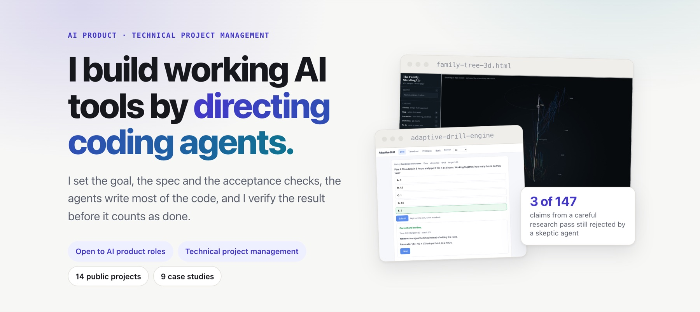

<a href="https://ryanwisth.github.io/">
  <picture>
    <source media="(prefers-color-scheme: dark)" srcset="https://raw.githubusercontent.com/ryanwisth/ryanwisth/main/assets/banner-dark.jpg">
    
  </picture>
</a>

# Ryan Wisth

**I build working AI tools by directing coding agents.** I set the goal, the spec and the acceptance checks, the agents write most of the code, and I verify the result before it counts as done.

I am looking for **AI product** and **technical project management** roles.

**[Portfolio site](https://ryanwisth.github.io/)** &nbsp;·&nbsp; [Case studies](#case-studies) &nbsp;·&nbsp; [Featured projects](#featured-projects) &nbsp;·&nbsp; [How I work](#how-i-work)

Each project below is public, runs on invented or sample data, and states its real status and limits in its README.

## Case studies

Short write-ups for readers who want the outcome, not the code: the problem, what I directed, how the results were verified, and what came of it.

| Case study | What it shows |
|---|---|
| [Making AI work easy to check](https://ryanwisth.github.io/checking-ai-work.html) | Trust in AI output. One principle across the evidence pipeline, the claim ledger and the token guard. |
| [A 3D family tree that opens from one file](https://ryanwisth.github.io/family-tree-3d.html) | A visual product from messy data, from the family tree viewer. |
| [A study app built around mistakes](https://ryanwisth.github.io/practice-engine.html) | Product rules set from a user problem, from the drill engine. |
| [A family tree built only from real records](https://ryanwisth.github.io/evidence-pipeline.html) | Research that has to cite its records, from the evidence pipeline. |
| [A fact-checking routine that stopped slipping](https://ryanwisth.github.io/claim-ledger.html) | A process failure turned into code, from the claim ledger. |
| [Spending rules an AI can’t skip](https://ryanwisth.github.io/token-guard.html) | Rules enforced in code instead of the prompt, from the token guard. |
| [Finding where my AI spending went](https://ryanwisth.github.io/token-scan.html) | Measuring AI cost before cutting it, from the token scan. |
| [Long AI jobs that check the bill first](https://ryanwisth.github.io/agent-runner.html) | Guardrails for unattended AI work, from the agent runner. |
| [Giving the AI on my laptop tools to use](https://ryanwisth.github.io/mcp-servers.html) | Tools shaped for the model that reads them, from the MCP servers. |
| [A private AI assistant on my laptop](https://ryanwisth.github.io/local-ai-stack.html) | Many parts made to work on one machine, from the local AI stack. |
| [AI feedback, handwritten onto a paper tablet](https://ryanwisth.github.io/paper-grader.html) | AI inside a physical device, from the paper grader. |
| [A study set up so it could prove me wrong](https://ryanwisth.github.io/pinball-study.html) | Pre-registered research with a negative result, from the pinball scorer. |
| [A study app where one wrong answer resets your streak](https://ryanwisth.github.io/streaks-trainer.html) | A method the product enforces, from the streaks trainer. |
| [Dark mode for any website in Safari](https://ryanwisth.github.io/safari-dark-mode.html) | A small product shipped end to end. |
| [Claude Code, run from my iPhone](https://ryanwisth.github.io/claude-phone.html) | Mobile access to a desktop tool over a private network; repo: private. |

## Featured projects

### [genealogy-evidence-pipeline](https://github.com/ryanwisth/genealogy-evidence-pipeline)

Grows a family tree only from records. AI agents propose additions, Python checks what code can check, a second model tries to refute each claim, and accepted facts go into an append-only ledger with the quote they rest on.

> **Proof.** Runs end to end offline on an invented 420-person family with one command. On the private tree it was built for, the skeptic agents rejected 31 claims from a fast first pass and 3 of 147 from a careful one.

### [claude-code-token-guard](https://github.com/ryanwisth/claude-code-token-guard)

Four hooks and nine cost-tiered subagent types that stop a Claude Code session, and the agents it spawns, from spending far more tokens than the work needs.

> **Proof.** Every rule follows a measured leak in real session logs. One example: 482 of 662 spawned agents were running as the heavy default type, with a median first call of 53.8k tokens against 16k to 20k for the lean types.

### [claim-ledger](https://github.com/ryanwisth/claim-ledger)

A Claude Code skill and command-line tool for fact-checking a long AI-written report one claim at a time, riskiest first, with an add-only log of every verdict.

> **Proof.** Built from a real 517-claim report checked in 29 batches. Replaying that ledger's 546 records reproduces its hand-made audit. Ships a 27-check self-test.

### [local-llm-mcp-servers](https://github.com/ryanwisth/local-llm-mcp-servers)

Six small MCP (Model Context Protocol) servers that give a locally hosted LLM live world events, market data, a dependency audit, a study coach and equation OCR.

> **Proof.** Tools are shaped for a mid-sized local model: short tool lists, capped replies, arithmetic done in code. The README gives each server's status separately, from "working" to "built, not yet run with a key".

### [adaptive-drill-engine](https://github.com/ryanwisth/adaptive-drill-engine)

A local practice app for any multiple-choice subject. It groups questions by the mistake they test and drills each mistake pattern until it is mastered under time.

> **Proof.** One Python file and one HTML file, standard library only. Comes with 21 original sample items, each with a machine check, and an importer for your own questions.

### [family-tree-3d](https://github.com/ryanwisth/family-tree-3d)

Turns a GEDCOM genealogy file into one self-contained, offline HTML page with a 3D family tree, a migration map, lineage and statistics views.

> **Proof.** The 3D view is raw WebGL with no library. Two builds of the sample produce a byte-identical data file, and the build refuses to combine mismatched payloads.

## How I work

- **Measure first.** The token guard's rules came from scanning my own session logs, and each hook was checked against the following week's scan.
- **Put the rule in code, not in the prompt.** Written rules in a prompt did not hold, so the guard enforces them at the tool call. The claim ledger's record template is enforced the same way, after its first run showed the discipline slipping in late batches.
- **Have a second pass try to refute the first.** In the genealogy pipeline a skeptic agent's stance is "when you cannot confirm, reject".
- **State the limits.** Each README says what was verified, what was not, and what was left out.

## More projects

| Project | What it is |
|---|---|
| [pinball-fun-scorer](https://github.com/ryanwisth/pinball-fun-scorer) | Pinball layout converter, 2D simulator and skill bots testing whether table design predicts player ratings |
| [remarkable-paper-grader](https://github.com/ryanwisth/remarkable-paper-grader) | Grades handwritten work on a reMarkable Paper Pro, with AI feedback written back as ink strokes |
| [paper-pro-display-re](https://github.com/ryanwisth/paper-pro-display-re) | Reverse engineering the reMarkable Paper Pro color e-ink display |
| [claude-code-token-scan](https://github.com/ryanwisth/claude-code-token-scan) | Scans Claude Code transcripts and reports token usage by project, model, day, session and tool |
| [agent-sdk-runner](https://github.com/ryanwisth/agent-sdk-runner) | Runs Markdown briefs through the Claude Agent SDK with auth, budget and turn guards |
| [local-ai-stack](https://github.com/ryanwisth/local-ai-stack) | Reference setup and runbook for a private, loopback-only local AI stack on an Apple-silicon Mac |
| [streaks-trainer](https://github.com/ryanwisth/streaks-trainer) | Local streak-mastery practice app |
| [safari-dark-mode](https://github.com/ryanwisth/safari-dark-mode) | Safari extension for macOS with dark mode for any site in six themes |
